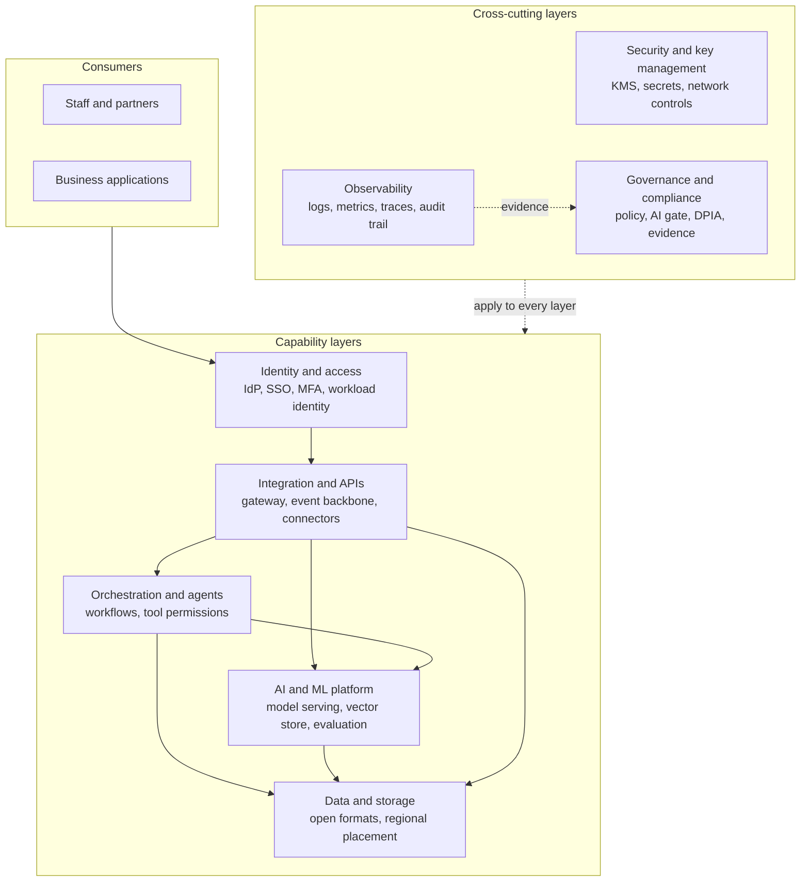
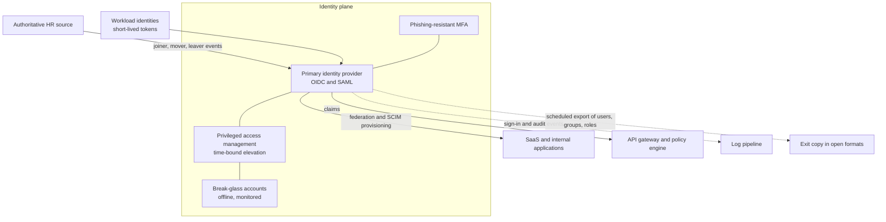
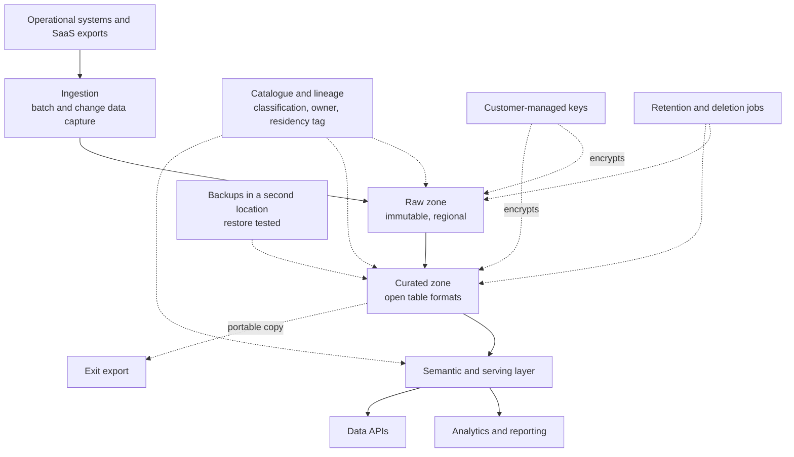
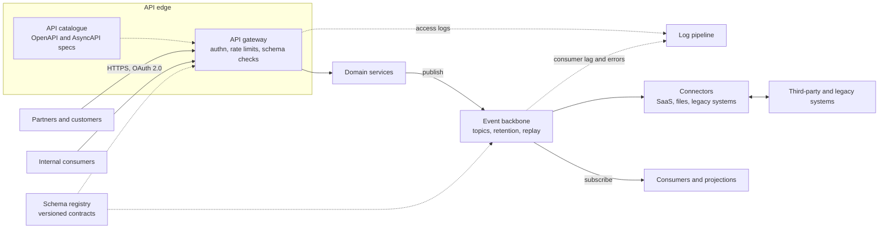
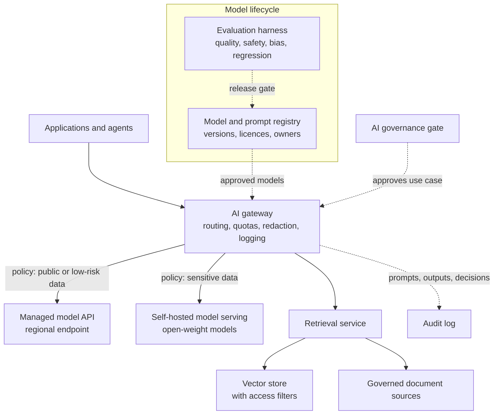
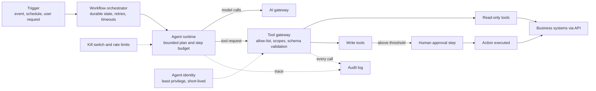
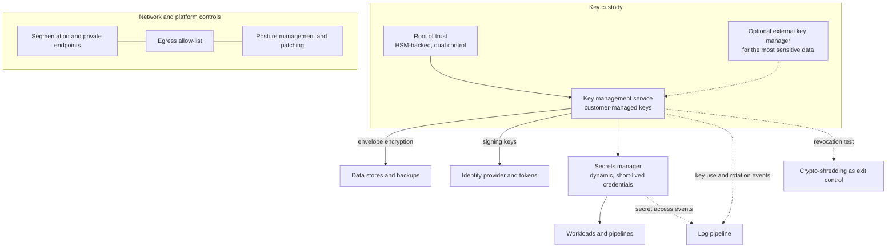
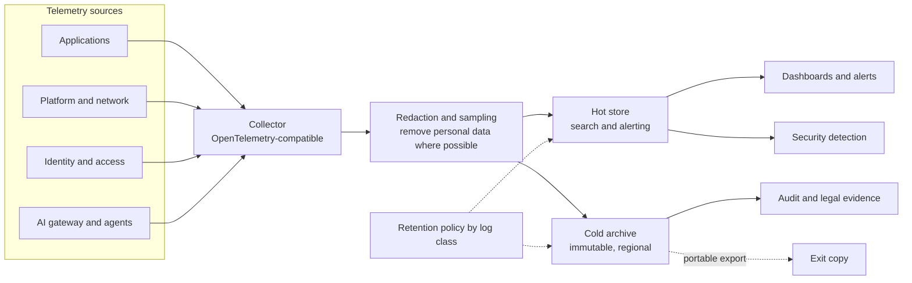
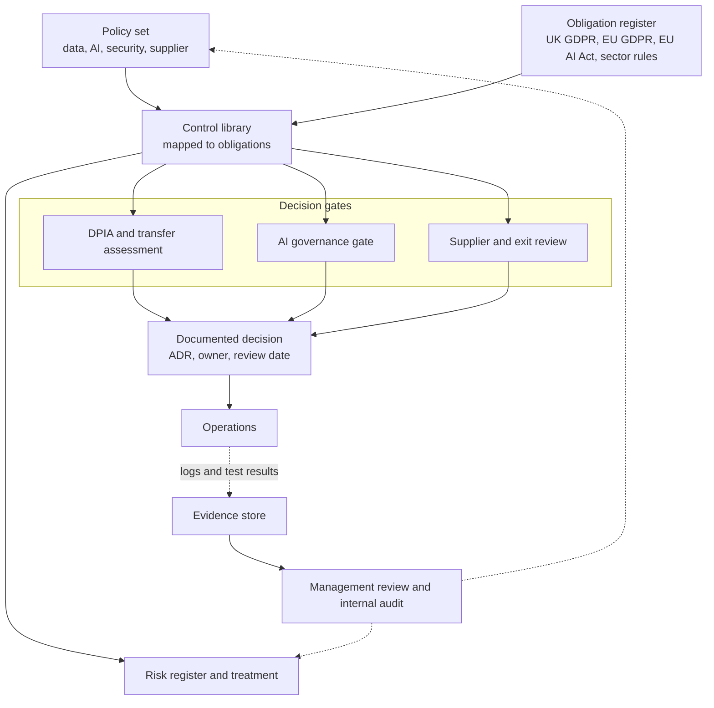

# Layered reference architecture

This document describes eight layers. Each section gives the purpose of the layer, the diagram, the design points that matter for control, portability and auditability, an explicit note on what the layer does **not** guarantee, and the decision records that apply.

Diagrams are written in [Mermaid](https://mermaid.js.org/), so GitHub renders them in place. Rendered PNG copies live in [`docs/diagrams/`](diagrams/) next to the `.mmd` sources, and CI checks that the two stay in step.

## How the layers fit together

Static image: [01-overview.png](diagrams/01-overview.png)

Five layers form the request path: identity and access, integration and APIs, orchestration and agents, the AI and ML platform, and data and storage. Three layers apply to everything: security and key management, observability, and governance and compliance. Reading order for a first pass: overview, then the layer that matches your biggest worry, then the linked decision records.

A note on vocabulary. In this repository a *layer* is a group of capabilities, not a product category and not a network tier. One product may deliver several layers and one layer may use several products. That is normal, and it is the reason the decision records focus on **interfaces and exit paths** rather than on product names.

---

## 1. Identity and access

**Purpose.** Establish who or what is acting, prove it, and decide what it may do. Everything else in the stack depends on this layer, so it is usually the highest-leverage place to invest in control.

Static image: [02-identity-access.png](diagrams/02-identity-access.png)

**Design points**

- One primary identity provider (IdP) for people, with federation to SaaS applications over open protocols (OpenID Connect, SAML 2.0) and provisioning over SCIM where the application supports it.
- Workload identities (services, pipelines, agents) are issued short-lived credentials by the same trust root, not long-lived shared secrets.
- Privileged access is time-bound and approved. Break-glass accounts exist, are stored offline, and trigger an alert when used.
- A scheduled export of users, groups, roles and application assignments in an open format gives you an **exit copy**. Without it, leaving the IdP means rebuilding access by hand.
- The authoritative source for joiners, movers and leavers is the HR system, not the IdP.

**What this layer does not guarantee.** Self-hosting an IdP does not make it more secure than a well-run managed one; it moves operational responsibility to you. A managed IdP does not remove the need to plan for its outage or exit.

**Decisions:** [ADR-0001 Identity provider approach](adr/0001-identity-provider-approach.md), [ADR-0009 Exit strategy and portability tests](adr/0009-exit-strategy-and-portability-tests.md).

---

## 2. Data and storage

**Purpose.** Hold operational and analytical data where you intend it to be, in formats you can read without the original vendor, protected by keys you control, for as long as you need it and no longer.

Static image: [03-data-storage.png](diagrams/03-data-storage.png)

**Design points**

- Every dataset has an owner, a classification, a residency tag and a retention rule recorded in a catalogue. Placement decisions follow the tag.
- Curated data is stored in open file and table formats (for example Parquet with an open table format) so that compute engines can be changed without a bulk conversion.
- A raw, immutable zone lets you rebuild curated data after an error or a platform move.
- Encryption uses customer-managed keys where the data classification justifies it (see the security layer).
- Backups live in a second location, and a restore is rehearsed on a schedule.

**What this layer does not guarantee.** Storing data in a UK or EU region reduces some exposures but does not by itself settle legal jurisdiction, access by provider staff, or support-access paths. See [UK and EU considerations](uk-eu-considerations.md).

**Decisions:** [ADR-0002 Data residency approach](adr/0002-data-residency-approach.md), [ADR-0011 Open data formats and storage abstraction](adr/0011-open-data-formats-and-storage-abstraction.md).

---

## 3. Integration and APIs

**Purpose.** Let systems exchange data and trigger each other through documented, versioned contracts, so that replacing one system does not mean rewriting every other one.

Static image: [04-integration-apis.png](diagrams/04-integration-apis.png)

**Design points**

- A single API edge (gateway) handles authentication, rate limiting and schema checks for external and internal consumers. Specifications are published (OpenAPI for request/response APIs, AsyncAPI for events).
- An event backbone decouples producers from consumers and allows replay. Event schemas are versioned in a registry.
- Connectors to third-party and legacy systems are isolated behind adapters. The adapter is the thing you replace when the system behind it changes.
- Contracts belong to your organisation, not to a vendor's connector catalogue. Keep the specification in your repository even if a vendor generates the connector.

**What this layer does not guarantee.** Open interfaces reduce switching cost but do not remove it. Behavioural differences, rate limits, and data-model mismatches still need testing during any migration.

**Decisions:** [ADR-0006 API gateway](adr/0006-api-gateway.md), [ADR-0007 Event backbone](adr/0007-event-backbone.md).

---

## 4. AI and ML platform and model serving

**Purpose.** Provide governed access to models (managed or self-hosted), retrieval over your own content, and the evaluation needed to know whether a use case is fit for purpose.

Static image: [05-ai-ml-platform.png](diagrams/05-ai-ml-platform.png)

**Design points**

- Applications never call a model provider directly. They call an internal **AI gateway** that applies routing policy, quotas, redaction and logging. This is the single place where a model can be swapped.
- Routing policy ties the model endpoint to the data classification of the request. A hybrid approach is the default recommendation: sensitive workloads use a self-hosted or private endpoint, lower-risk workloads may use a managed API.
- Retrieval respects the caller's entitlements. A vector store that ignores source permissions can leak content between users.
- Models, prompts and evaluation sets are versioned. A model's licence terms are recorded alongside it, because "open-weight" does not mean "unrestricted".
- Every use case passes the AI governance gate before it reaches production.

**What this layer does not guarantee.** Self-hosting a model gives you control over where inference runs and what is logged. It does not make outputs correct, unbiased or lawful. Provider terms on data use, retention and sub-processors still need to be read and recorded for any managed service.

**Decisions:** [ADR-0004 Model hosting options](adr/0004-model-hosting-options.md), [ADR-0005 Vector store selection criteria](adr/0005-vector-store-selection-criteria.md), [ADR-0010 AI governance gate](adr/0010-ai-governance-gate.md).

---

## 5. Orchestration and agents

**Purpose.** Run multi-step workflows reliably, and, where justified, let software agents plan and act within strict limits.

Static image: [06-orchestration-agents.png](diagrams/06-orchestration-agents.png)

**Design points**

- A workflow orchestrator owns durable state, retries and timeouts. An agent is one step type inside a workflow, not a replacement for it.
- Agents act only through a **tool gateway** that enforces an allow-list, scopes and input validation. Read-only tools are separated from tools that change state.
- Each agent has its own identity with the minimum permissions needed. It does not inherit a human user's full access.
- State-changing actions above an agreed threshold require a human approval step. The threshold is a business decision recorded in the use case file.
- A kill switch and rate limits can stop an agent without a deployment.
- Every tool call and model call is logged with enough context to reconstruct what happened and why.

**What this layer does not guarantee.** Guardrails reduce the likelihood and impact of agent errors; they do not eliminate them. Prompt injection through untrusted content remains an open problem, so the design assumes that an agent can be misled and limits what a misled agent can do.

**Decisions:** [ADR-0012 Agent autonomy and tool permissions](adr/0012-agent-autonomy-and-tool-permissions.md), [ADR-0010 AI governance gate](adr/0010-ai-governance-gate.md).

---

## 6. Security and key management

**Purpose.** Protect confidentiality, integrity and availability across the stack, and give the organisation a credible way to revoke a provider's ability to read its data.

Static image: [07-security-key-management.png](diagrams/07-security-key-management.png)

**Design points**

- Key custody is explicit: who creates keys, where they live, who can use them, how they rotate and how they are revoked. Customer-managed keys are the recommended default for data classified as confidential or above; an external key manager is reserved for the most sensitive data and carries real availability trade-offs.
- Secrets are issued dynamically and expire quickly, and they are never stored in source repositories or configuration files.
- Network controls are the boring ones that matter: segmentation, private endpoints to managed services, and an egress allow-list so that a compromised workload cannot send data anywhere it likes.
- Revoking or destroying a key can render the encrypted data unreadable ("crypto-shredding"). This is a useful exit control, provided backups and replicas are covered by the same keys.

**What this layer does not guarantee.** Customer-managed keys limit what a provider can read at rest. Data in use (in memory during processing) is generally visible to the processing system unless confidential computing is used, and that has its own limits. Key management does not protect against a compromised administrator in your own organisation.

**Decisions:** [ADR-0003 Bring your own key and key custody](adr/0003-bring-your-own-key-and-key-custody.md).

---

## 7. Observability

**Purpose.** Know what the system is doing, detect problems and misuse, and keep the evidence needed for audits and investigations without creating a second, uncontrolled personal-data store.

Static image: [08-observability.png](diagrams/08-observability.png)

**Design points**

- Telemetry is collected through a vendor-neutral standard (OpenTelemetry-compatible) so that the back end can change.
- Personal data is redacted or avoided in logs at the collector, before storage.
- Retention is set by log class (security, audit, application, debug), not as a single number. Hot storage supports search and alerting; a cold archive supports evidence.
- Logs of AI interactions are treated as personal and potentially sensitive data in their own right.
- The archive is exportable in an open format and stored in an agreed region.

**What this layer does not guarantee.** Comprehensive logging is not the same as comprehensive detection. Someone has to look, and alert rules need tuning.

**Decisions:** [ADR-0008 Logging and retention](adr/0008-logging-and-retention.md).

---

## 8. Governance and compliance

**Purpose.** Make decisions explicit, owned and reviewable, and connect the technical controls to the obligations they are meant to support.

Static image: [09-governance-compliance.png](diagrams/09-governance-compliance.png)

**Design points**

- An obligation register lists the laws, contracts and standards that apply, with an owner for each. The control library maps technical and organisational controls to those obligations.
- Three decision gates catch most of the risk: a data protection impact assessment and transfer assessment for new processing; an AI governance gate for new AI use cases; and a supplier and exit review for new platforms.
- Decisions are recorded as short architecture decision records with an owner and a review date.
- Evidence is collected as a by-product of operations (logs, test results, approvals), not assembled in a panic before an audit.
- Management review closes the loop and feeds back into policy and the risk register.

**What this layer does not guarantee.** Documentation shows intent and process. It is not proof that controls work. Independent testing and internal audit are what turn documents into assurance.

**Decisions:** [ADR-0010 AI governance gate](adr/0010-ai-governance-gate.md), [ADR-0009 Exit strategy and portability tests](adr/0009-exit-strategy-and-portability-tests.md).

---

## Where to go next

- Score your current position with the [maturity model](maturity-model.md).
- Test exit readiness with the [checklist](exit-readiness-checklist.md).
- Compare options with the [weighted decision matrix template](decision-matrix-template.md).
- Plan the work with the [six-month adoption roadmap](how-to-adopt.md).
